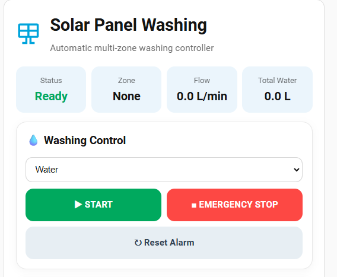
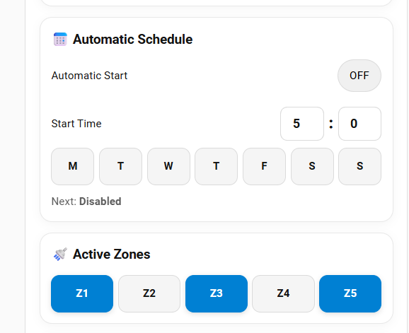
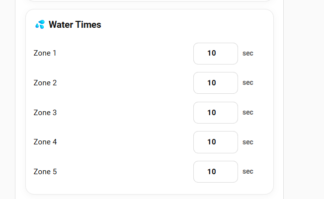
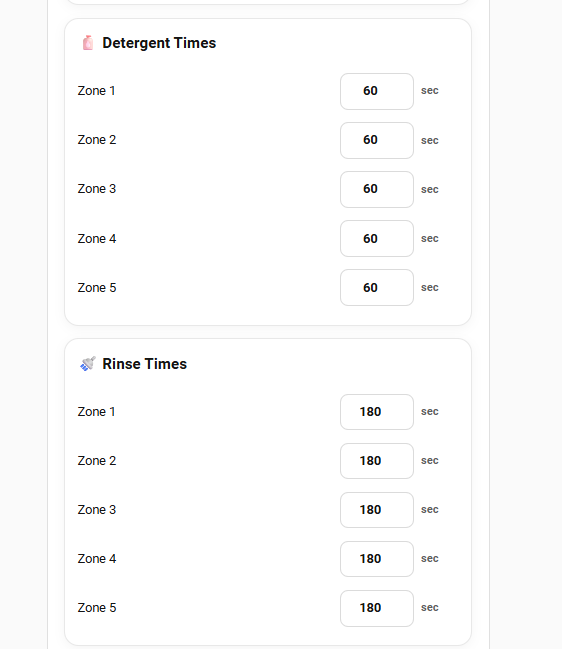
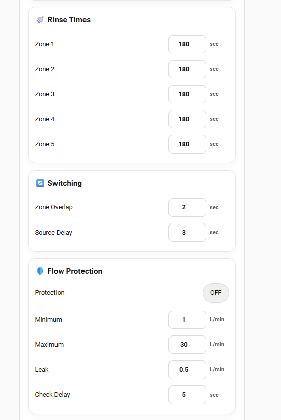
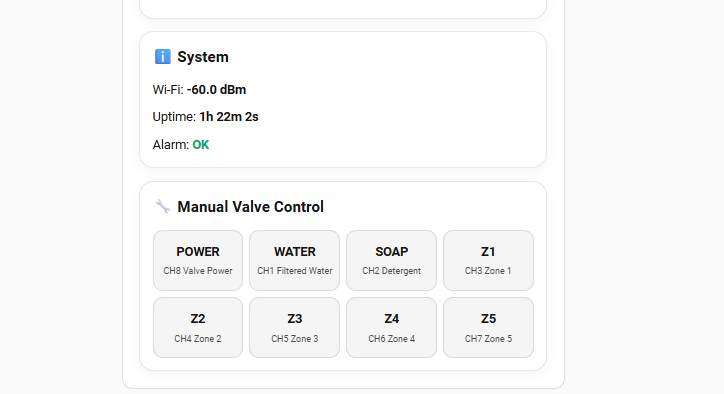

## HACS Integration — single installation (v1.3.0+)

This repository is now a **HACS Integration**, not a HACS Dashboard/Frontend plugin. The Python integration bundles the JavaScript cards and registers the Lovelace resource automatically.

**One-time migration from the old Dashboard plugin:**
1. In HACS, remove the **old Dashboard/Frontend repository installation** (not your dashboards or ESPHome device).
2. Add `https://github.com/EvgenyKrinets/solar-panel-washing` as a **custom repository of type Integration**, then install it.
3. Restart Home Assistant when prompted.
4. Go to **Settings → Devices & services → Add integration → Solar Panel Washing Dashboard**, and confirm.
5. A new sidebar dashboard with ten independent cards is provisioned once. Your other dashboards and settings remain unchanged.

**Future releases:** HACS updates the Python backend and bundled JS together. A Home Assistant restart may be needed to load the new version. HACS does not install updates silently by default. Dashboard edits are preserved; the installer does not replace existing dashboard content.

**Migration note:** The old frontend plugin and the new integration must not both register the same card JS resource. Remove the old Lovelace resource if the browser reports duplicate custom-element registrations. Existing manually configured cards remain supported.

**Limitations:** Lovelace YAML-managed resources require adding the bundled module URL manually (`/solar-panel-washing/solar-panel-washing.js`). The integration has not yet been end-to-end tested on a running HA installation.

<div align="center">
  

# Solar Panel Washing

### Automatic multi-zone solar-panel washing with ESP32, ESPHome and Home Assistant


[](https://esphome.io/)
[](https://www.home-assistant.io/)
[](#languages)
[](https://github.com/EvgenyKrinets/solar-panel-washing/blob/main/LICENSE)


</div>

## Languages

The Home Assistant dashboard supports **three interface languages**:

- 🇺🇸 **English** — default.
- 🇷🇺 **Русский** — Russian.
- 🇮🇱 **עברית** — Hebrew.

Use the **🌐 language selector** in the dashboard header. The **Auto** setting follows your Home Assistant language (English, Russian or Hebrew); other Home Assistant languages fall back to English. The language selector changes the dashboard labels and explanatory text only. ESPHome entity names, control commands, washing programs and safety behavior remain unchanged.


## Automatic dashboard installer (Home Assistant integration)

The repository now also contains a **Home Assistant backend integration** at
[`custom_components/solar_panel_washing_dashboard/`](custom_components/solar_panel_washing_dashboard/).

**Install once:**
1. Keep the **Solar Panel Washing Dashboard** JavaScript card installed through HACS.
2. Copy the folder `custom_components/solar_panel_washing_dashboard` from this repository to `/config/custom_components/solar_panel_washing_dashboard` in Home Assistant.
3. Restart Home Assistant.
4. Open **Settings → Devices & services → Add integration**, search for **Solar Panel Washing Dashboard Installer**, and confirm installation.
5. A new sidebar dashboard **Solar Panel Washing** is created with ten independent section cards, up to three columns wide. Each card can be moved or copied to another dashboard.

The installer creates the dashboard **only if it does not already exist**. It never overwrites your edits, never changes other dashboards, and never deletes a dashboard when the integration is removed. Reinstalling or updating the integration preserves an existing dashboard.

**Note:** HACS's dashboard/frontend plugin does **not** install Python backend integrations. Until this component is distributed as a separate HACS Integration, step 2 is required. Updating the JavaScript card alone cannot provision the dashboard. The new backend installer has not yet been tested on a live Home Assistant installation; please report any errors from Settings → System → Logs.

## Ready-made modular dashboard

A complete 10-section Home Assistant dashboard is provided at [home-assistant/modular-dashboard.yaml](home-assistant/modular-dashboard.yaml). Create a new dashboard, open its raw YAML editor, and paste the file contents. It uses a Sections view with up to three columns on desktop and a responsive mobile layout. Existing dashboards remain unchanged.

**Important:** HACS installs the custom card frontend only. It does not have permission to automatically create or replace Lovelace dashboards. Truly automatic dashboard provisioning requires a separate Home Assistant backend integration and explicit authorization.

## Individual cards in Home Assistant (v1.1.32+)

In **Edit dashboard → Add card**, search **Solar Washing**. Each section is now a separate selectable card with its own preview:

**Washing Control, Automatic Schedule, Active Zones, Water Times, Detergent Times, Rinse Times, Switching, Flow Protection, System, Manual Valve Control.**

Select the desired card directly and place it in a Sections dashboard column. No YAML configuration is needed for these individual cards.

Example for a single independent Water Times card:

```yaml
type: custom:solar-panel-washing-water-times-card
```

Other section cards follow the same naming pattern (e.g. `solar-panel-washing-zones-card`, `solar-panel-washing-flow-protection-card`). The combined card remains available separately.

## Reusable dashboard sections (v1.1.30+)

You can still use the complete dashboard card:

```yaml
type: custom:solar-panel-washing-card
```

Alternatively, add **independent section cards** to any Home Assistant dashboard using the same HACS JavaScript resource:

```yaml
type: custom:solar-panel-washing-section-card
section: water-times
```

Available `section` values:

| Section | Contents |
| --- | --- |
| `control` | Manual washing mode, start, stop, alarm reset |
| `schedule` | Weekly automatic schedule |
| `zones` | Enable or disable zones |
| `water-times` | Water-only wash duration for each zone |
| `detergent-times` | Detergent duration |
| `rinse-times` | Post-detergent rinse duration |
| `switching` | Zone overlap and source delay |
| `flow-protection` | Flow safety thresholds |
| `system` | Wi-Fi, uptime and alarm |
| `manual-valves` | Direct valve/relay controls |

To arrange three cards side by side, use a **Grid card** with three columns in a sufficiently wide dashboard:

```yaml
type: grid
columns: 3
square: false
cards:
  - type: custom:solar-panel-washing-section-card
    section: zones
  - type: custom:solar-panel-washing-section-card
    section: water-times
  - type: custom:solar-panel-washing-section-card
    section: rinse-times
```

For automatic responsive placement, use a Home Assistant **Sections** view and adjust the view's column layout. The full card also uses a responsive grid: up to three columns on wide displays and one column on narrow screens. Home Assistant view layout can limit the available width. Separate section cards keep their existing actions and settings; this is a dashboard-only change.

## Overview

Solar Panel Washing is a local-first automatic washing controller for rooftop photovoltaic arrays. The ESP32 runs the washing sequence and safety logic locally, while Home Assistant provides a clean interface for starting, stopping, scheduling and tuning the system.

The reference hardware is the **Waveshare ESP32-S3-ETH-8DI-8RO**. Eight relay channels control two source valves, five washing zones and the valve-transformer power supply.

## Highlights

- 💧 **Water mode** with configurable washing time for every zone.
- 🧴 **Detergent + Water mode** with separate detergent and rinse times.
- 🚿 **Five independent washing zones** that can be enabled or disabled individually.
- 🔄 **Zone overlap** opens the next zone before closing the previous one.
- 🛡️ **Flow protection** for low flow, high flow and unexpected flow/leak detection.
- 📅 **Local weekly scheduler** with selectable weekdays and start time.
- 🛑 **Emergency stop** and alarm reset.
- ⚡ **Transformer control** so valve power does not remain energized unnecessarily.
- 📱 **Responsive Home Assistant dashboard** for desktop and mobile.
- 🏠 The washing sequence continues locally on the ESP32 if Home Assistant disconnects.

## Dashboard screenshots

Real screenshots of the Home Assistant dashboard, showing the controls and configuration sections.

### Washing control



### Automatic schedule and zones



### Water times



### Detergent and rinse times



### Switching and flow protection



### System and manual valves



## Relay map

| Relay | Function |
|---|---|
| CH1 | Filtered water source valve |
| CH2 | Detergent source valve |
| CH3 | Zone 1 |
| CH4 | Zone 2 |
| CH5 | Zone 3 |
| CH6 | Zone 4 |
| CH7 | Zone 5 |
| CH8 | Valve transformer power |

CH1 and CH2 use an ESPHome interlock and are not intended to be active simultaneously.

## Flow meter

The current configuration is prepared for a **YF-B5 G3/4** flow meter using **396 pulses/liter** on DI1 / GPIO4. Flow Protection is OFF by default so the controller can be installed and tested before the meter is connected.

> **Important:** verify the electrical output of your actual flow-meter unit and the Waveshare digital-input requirements before wiring its signal line.

## Installation

### Recommended: HACS Dashboard Card

The project now includes an installable Home Assistant frontend card. Add this repository to HACS as a **Dashboard** custom repository:

`https://github.com/EvgenyKrinets/solar-panel-washing`

Install **Solar Panel Washing Dashboard** (category **Dashboard**) and reload the Home Assistant frontend. HACS should register the JavaScript resource automatically. Then use **Edit dashboard → Add card → Solar Panel Washing**, or add one card manually:

```yaml
type: custom:solar-panel-washing-card
```

If the card is not listed after an update, use **Redownload** in HACS, then refresh Home Assistant. The expected resource path is `/hacsfiles/solar-panel-washing/solar-panel-washing.js` (do not register a duplicate resource if HACS has already created one).

The card automatically uses the standard `solar_panel_washing_...` entity IDs created by this project and provides the complete responsive interface in one card. Updates can then be delivered through HACS instead of copying the dashboard YAML again.

The classic all-standard-cards dashboard remains available in `home-assistant/dashboard.yaml`.

### 1. ESPHome

Copy `esphome/solar-panel-washing.yaml` to your ESPHome configuration directory.

Add the values from `esphome/secrets.example.yaml` to your own `secrets.yaml`. Keep your real Wi-Fi password and API encryption key private.

Validate, compile and install the configuration from ESPHome Device Builder.

### 2. Home Assistant

After Home Assistant discovers the ESPHome device, confirm that its entities are available.

Create a new dashboard in Home Assistant, open its raw YAML editor and paste the contents of:

`home-assistant/dashboard.yaml`

The supplied dashboard uses only standard Home Assistant cards—no third-party frontend card is required.

> Home Assistant normally preserves an entity's original `entity_id` when an ESPHome entity is renamed. If your controller was already installed before this project, compare the entity IDs in the dashboard YAML with your existing entities.

## Dashboard layout

The dashboard separates controls by purpose instead of putting everything into one long card:

- **Washing Control** — mode, status, START, Emergency Stop and alarm reset.
- **Automatic Schedule** — start time plus compact **M T W T F S S** day buttons.
- **Active Zones** — five compact zone buttons.
- **Water / Detergent / Rinse Times** — individual timing for every zone.
- **Switching Settings** — overlap and source-change delay.
- **Flow Protection** — live flow, limits, leak threshold and total water.
- **Manual Valve Control** — service/testing controls for CH1–CH8.
- **System Status** — controller, alarm, Wi-Fi, uptime and network information.

## Safety

This project controls real valves and may switch a transformer. Confirm relay contact ratings, valve voltage/current, transformer protection, wiring, earthing and local electrical requirements before connecting loads.

Manual CH1–CH8 entities intentionally remain available for commissioning and service. They can bypass the normal automatic sequence, so use the **Manual Valve Control** section carefully.

After power loss or ESP32 reboot, relay outputs are configured **ALWAYS_OFF** and a wash does not automatically resume.

## Files

```
solar-panel-washing/
├── VERSION
├── README.md
├── LICENSE
├── hacs.json
├── solar-panel-washing.js (HACS entrypoint)
├── solar-panel-washing-card.js (legacy)
├── assets/
│   ├── icon.svg
│   └── dashboard-preview.svg
├── esphome/
│   ├── solar-panel-washing.yaml
│   └── secrets.example.yaml
└── home-assistant/
    └── dashboard.yaml
```

## Version 1.1.0

- Added installable HACS Dashboard card
- Complete responsive UI is now available as one custom card
- Compact weekday and zone controls
- START, Emergency Stop and Reset controls
- Water, detergent and rinse timing controls
- Flow protection and manual valve controls
- HACS-based frontend updates

## Version 1.0.0

Initial public release:

- Waveshare ESP32-S3-ETH-8DI-8RO relay mapping
- Water and detergent/rinse programs
- Five selectable zones
- Weekly automatic scheduling
- Configurable timing and overlap
- YF-B5 flow-meter support
- Flow/leak protection
- Home Assistant desktop/mobile dashboard
- Project icon and dashboard artwork

## License

MIT License. See `LICENSE`.
